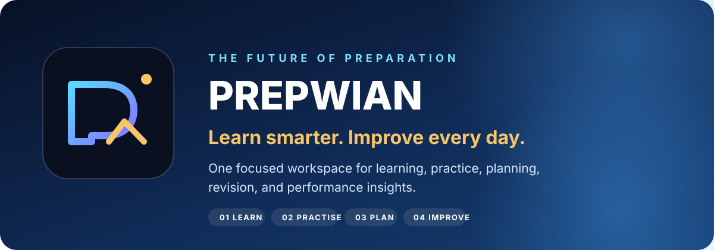

<div align="center">



# PREPWIAN

### The Future of Preparation.

**Learn smarter. Practise deliberately. Improve every day.**

[](https://react.dev/)
[](https://www.typescriptlang.org/)
[](https://vite.dev/)
[](https://supabase.com/)

</div>

---

PREPWIAN is an evolving preparation workspace designed to bring learning, practice, planning, revision, assessments, and progress insights into one focused experience. It is being developed with JEE Main, JEE Advanced, and NEET preparation in mind.

> **Product principle:** useful tools, clear progress, fewer distractions. Features and availability depend on the current application build and account permissions.

## The preparation loop

1. **Learn** — organise topics, notes, and study resources.
2. **Practise** — build consistency through quizzes and question practice.
3. **Plan** — structure lectures, daily targets, and backlog recovery.
4. **Review** — inspect mistakes, revisit weak areas, and adjust the next session.

## Core areas

- Study resources and revision workflows
- Practice, quizzes, and assessment experiences
- Daily planning, lecture tracking, and backlog management
- Focus sessions and study activity
- Progress views and performance insights
- Student community and account features
- Administration and moderation tools for authorised users

The list describes intended product areas; it is not a guarantee that every feature is enabled in every deployment.

## Technology stack

| Layer             | Technologies                                       |
| :---------------- | :------------------------------------------------- |
| Application       | React, TypeScript, TanStack Start, TanStack Router |
| UI                | Tailwind CSS, Radix UI, Lucide                     |
| Build             | Vite, ESLint, Prettier                             |
| Data and services | Supabase, PostgreSQL, Supabase Auth, Realtime      |

## Run locally

Requirements: Node.js version specified in `package.json` and npm.

```bash
npm install
cp .env.example .env
# Add your own development environment values to .env
npm run dev
```

Build the application with `npm run build`. Never commit `.env` files, service-role keys, access tokens, or other secrets.

## Project structure

```text
public/       Brand assets and static files
src/          Routes, components, features, and application logic
supabase/     Database configuration and migrations
docs/         Project and student documentation
```

## Development notes

- Keep changes focused and preserve existing working interfaces unless a migration is intentional.
- Validate permissions on the server/database; hiding a UI control is not an authorization boundary.
- Do not commit credentials or real user data.
- Test locally before deploying changes.

## Status

PREPWIAN is in active development. A source archive is not the same as a deployment; changes must be committed and deployed separately.
