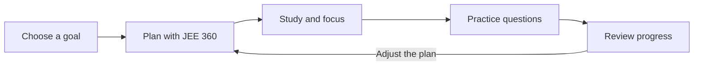

<div align="center">


# JEE Prep Hub

### A focused workspace for every part of JEE preparation.

**Study. Practice. Plan. Improve.**

[](https://react.dev/)
[](https://www.typescriptlang.org/)
[](https://vite.dev/)
[](https://supabase.com/)
[](roadmap.md)

[Explore the code](#-technology-stack) · [Run it locally](#-get-started) · [Quality checks](https://github.com/dhirendra-dev/prepwian/actions/workflows/quality.yml) · [Releases](CHANGELOG.md) · [Contribute](#-contributing)

</div>

---

JEE Prep Hub is an independent educational platform that brings study resources, practice, planning, focus tools, progress tracking, and student community features into one digital workspace. The goal is simple: spend less time organizing preparation and more time learning.

> **Built around preparation—not distraction.** Features and availability are evolving as the project develops.

## ✨ At a glance

| 📚 Learn                                                    | 🧪 Practice                                       | 📅 Plan                                                   | 📈 Improve                                             |
| :---------------------------------------------------------- | :------------------------------------------------ | :-------------------------------------------------------- | :----------------------------------------------------- |
| Organized academic materials, notes, and revision resources | Tests, quizzes, questions, and practice workflows | JEE 360 planning, lecture tracking, and backlog workflows | Study activity, streaks, analytics, and progress views |

| ⏱️ Focus                          | 👥 Connect                                      | 👤 Personalize                      | 🛡️ Manage safely                                          |
| :-------------------------------- | :---------------------------------------------- | :---------------------------------- | :-------------------------------------------------------- |
| Timers and focused study sessions | Study-oriented community, discussions, and chat | Profiles, preferences, and activity | Authentication, role-aware administration, and moderation |

_The feature overview describes areas of the application; exact access and availability may vary by account and as development continues._

## 🧭 The preparation loop



## 🔎 Explore the platform

- **Study materials** — Navigate academic resources across Physics, Chemistry, and Mathematics, with organization for classes, chapters, topics, notes, and practice.
- **JEE 360** — Bring daily preparation, lecture planning, backlog management, and progress into a single workflow.
- **Tests and quizzes** — Use assessment and practice experiences to reinforce learning and review performance.
- **Focus and consistency** — Structure study sessions with timers and view study activity, history, or streak-related progress.
- **Student community** — Find study-oriented discussion, doubt-solving, notices, posts, chat, and student interaction.
- **Profiles and achievements** — Personalize a student presence and see activity, progress indicators, and achievement-related features.
- **Administration and moderation** — Provide authorized administrators with tools to manage platform operations and community safety.

## 📖 Student documentation

New to the resource library? Start with the **[Study Materials guide](docs/student-guides/study-materials.md)** for help searching, filtering, previewing, and saving resources.

## 🖼️ A closer look

The repository includes a study-session visual used by the product:


## 🏗️ Technology stack

| Layer             | Technologies                                          |
| :---------------- | :---------------------------------------------------- |
| Application       | React 19, TypeScript, TanStack Start, TanStack Router |
| UI and styling    | Tailwind CSS, shadcn/ui, Radix UI, Lucide             |
| Build and tooling | Vite, ESLint, Prettier, npm or Bun                    |
| Data and services | Supabase, PostgreSQL, Supabase Auth, Realtime         |
| Database tooling  | Drizzle ORM and Drizzle Kit                           |

Dependency versions and available commands are maintained in [`package.json`](package.json).

## 📁 Project structure

```text
.
├── public/                 # Brand assets, icons, metadata, and public images
├── src/
│   ├── components/         # Shared UI and product components
│   ├── features/           # Feature-oriented application modules
│   ├── hooks/              # Reusable React hooks
│   ├── integrations/       # External-service integrations
│   ├── lib/                # Shared utilities and application logic
│   ├── pages/              # Page-level modules
│   └── routes/             # TanStack file-based routes
├── supabase/               # Supabase configuration and migrations
├── drizzle/                # Database schema and migration assets
├── .env.example            # Safe environment-variable template
├── package.json            # Scripts and dependencies
└── roadmap.md              # Current development roadmap
```

## 🚀 Get started

### Prerequisites

- Node.js 22.18 or newer, with npm (or Bun)
- Git
- A Supabase project for features that require backend services

### 1. Clone the repository

```bash
git clone https://github.com/dhirendra-dev/prepwian.git
cd prepwian
```

### 2. Install dependencies

```bash
npm ci
```

Alternatively, use Bun with the included `bun.lock`:

```bash
bun install
```

### 3. Configure your environment

Copy the example file and add the values for your development environment:

```bash
cp .env.example .env
```

At minimum, configure the Supabase project URL and publishable key for the features you intend to use. See [Environment variables](#-environment-variables) for important key-handling guidance.

### 4. Start the development server

```bash
npm run dev
```

Vite prints the local URL when the server is ready.

### 5. Build and check the project

```bash
npm run check
```

`npm run check` runs formatting checks for documentation and repository metadata, followed by a production build. A dedicated unit-test suite is not yet defined. The existing `npm run lint` command reports a large application-wide backlog and is not a blocking CI check yet; the rules have not been weakened or the app mass-reformatted. The passing checks run through the [GitHub Actions quality workflow](https://github.com/dhirendra-dev/prepwian/actions/workflows/quality.yml). See the [release guide](RELEASING.md) and [changelog](CHANGELOG.md) for versioned source releases.

## 🔐 Environment variables

Use `.env.example` as the source of truth for variable names. The app uses public Supabase configuration and, for trusted server-side operations, separate server-only secrets.

| Variable                                | Use                                                                           | Exposure           |
| :-------------------------------------- | :---------------------------------------------------------------------------- | :----------------- |
| `VITE_SUPABASE_URL`                     | Supabase URL for browser-side client configuration                            | Public             |
| `VITE_SUPABASE_PUBLISHABLE_KEY`         | Supabase publishable/anonymous client key                                     | Public             |
| `SUPABASE_URL`                          | Supabase URL for server functions                                             | Server environment |
| `SUPABASE_PUBLISHABLE_KEY`              | Supabase publishable key for server functions                                 | Server environment |
| `SUPABASE_SERVICE_ROLE_KEY`             | Privileged access for existing trusted server functions                       | **Server only**    |
| `SYSTEM_SETTINGS_ENCRYPTION_KEY`        | Encryption key for centrally managed system credentials                       | **Server only**    |
| `VITE_GITHUB_OWNER`, `VITE_GITHUB_REPO` | Optional repository details shown in the developer area                       | Public             |
| `GITHUB_TOKEN`                          | Optional server-side token for private-repository access or higher API limits | **Server only**    |

Never place service-role keys, encryption keys, private tokens, or other secrets in `VITE_*` variables or client-side code. Never commit `.env` files or real credentials. The repository ignores local environment files; commit the template `.env.example` only.

### Admin System Control Center

The full-admin System Control Center is available at `/admin/system` after its database migration and server configuration are in place:

1. Apply [`supabase/migrations/20261011090000_admin_system_secrets.sql`](supabase/migrations/20261011090000_admin_system_secrets.sql) to the connected Supabase project.
2. Generate a server-only encryption key with `openssl rand -base64 32` and configure it as `SYSTEM_SETTINGS_ENCRYPTION_KEY` in the deployment environment.
3. Configure the required Supabase server variables, including `SUPABASE_SERVICE_ROLE_KEY`, in the trusted server environment.
4. Deploy the server functions and application, then access `/admin/system` with a full-admin account.

Managed credentials are encrypted server-side. Do not expose privileged credential values to browser code or return them to clients. See [`SYSTEM_CONTROL_SETUP.md`](SYSTEM_CONTROL_SETUP.md) for the detailed setup notes.

## 🛡️ Security and privacy

- Keep credentials out of source control; use environment variables and hosting-provider secrets.
- Keep privileged keys and server-only helpers on the server.
- Use protected routes and authorized roles for administrative operations.
- Report suspected vulnerabilities privately and responsibly; do not publish exploit details in a public issue.

See [`SECURITY.md`](SECURITY.md) and [`CLOUDFLARE_SECURITY.md`](CLOUDFLARE_SECURITY.md) for security guidance.

## 🗺️ Roadmap and project status

JEE Prep Hub is under active development. Features, APIs, and interfaces may change, and some modules may be experimental. For current priorities and progress, see the **[project roadmap](roadmap.md)**.

## 🤝 Contributing

Contributions, issue reports, and thoughtful feedback are welcome. Start with the **[contribution guide](CONTRIBUTING.md)** and [Code of Conduct](CODE_OF_CONDUCT.md) for community expectations, setup, development practices, and pull-request guidance. Use the repository's [bug report](.github/ISSUE_TEMPLATE/bug_report.yml), [feature request](.github/ISSUE_TEMPLATE/feature_request.yml), or [documentation issue](.github/ISSUE_TEMPLATE/documentation.yml) form when reporting work. See [Support](SUPPORT.md) for the right channel for product questions, bugs, and documentation. Security concerns must be reported privately as described in [`SECURITY.md`](SECURITY.md).

## 📄 License

This project is licensed under the **MIT License**. You may use, copy, modify, merge, publish, distribute, sublicense, and/or sell copies of the software, subject to the conditions in the [`LICENSE`](LICENSE) file. The software is provided without warranty; see the license for the full terms.

## 🙏 Acknowledgements

JEE Prep Hub is an independent project built to support students preparing for competitive examinations. Thank you to everyone who tests features, reports issues, contributes feedback, or helps improve the platform. The project also relies on open-source software from the wider web-development ecosystem.

---

<div align="center">

**Make preparation more organized, measurable, and consistent.**

Built for aspirants. Built around preparation.

</div>

## Prep Lab — advanced practice workspace

The repository now includes **Prep Lab** at `/prep-lab`, linked from the Test Series page and the app's Tests & Practice menu.

### Prep Lab capabilities

- A generated bank of **2,000 original parameterised practice variants**: 500 each across Physics, Chemistry, Mathematics and Biology.
- Exam-track filtering for JEE Main, JEE Advanced and NEET UG, plus subject, chapter and difficulty filters.
- Four session strategies: balanced mix, smart weak topics, challenge mode and revision queue.
- 10, 20, 50 or 100-question sessions, optional time targets, question palette and progress tracking.
- Answer checking, explanations, bookmarking, recent mistakes, weak-topic summaries and retry flow.
- Import personal questions from JSON and export the generated + imported bank for backup or editing.
- Local attempts, bookmarks, goals and session history stored in browser `localStorage`.

### Important question-bank note

These 2,000 prompts are **original generated practice variants**, not official previous-year questions (PYQs), official NTA/IIT questions, or an expert-verified mock-paper set. They are produced from educational templates, and should be reviewed before use in a formal assessment. Existing verified PYQs and database-backed tests elsewhere in the project are not replaced.

### Running / environment safety

Create your local `.env` from `.env.example` and supply your own development credentials. Do not commit `.env` or service-role keys. The upgraded ZIP intentionally excludes `.env` files that can contain credentials. Prep Lab progress is local to the browser and does not yet sync across devices or to Supabase.

## Adaptive Study Plan (Prep Lab)

The Prep Lab includes a browser-local study plan that recommends a short daily sequence, shows chapter accuracy from recorded attempts, and surfaces missed topics for spaced review. Its suggestions are learning aids—not an official syllabus checklist or a guarantee of exam readiness. The Prep Lab question bank labels generated practice separately from official previous-year questions.

### Adaptive Syllabus Tracker

Prep Lab includes a personal chapter tracker with Not started, In progress, Completed, and Needs revision statuses. Progress is stored in the current browser alongside other Prep Lab data and separated by exam track. The chapter list reflects chapters currently represented in the Prep Lab question bank; it should not be treated as a complete official JEE or NEET syllabus checklist.

### Mock Test Intelligence Engine

Prep Lab includes a Mock Intelligence tab to log mock results manually or import a JSON array / CSV file, compare recent score percentages, review attempted-question accuracy and unattempted counts, and get next-step recommendations from saved mock results and subject-level Prep Lab practice history. Results are stored in the current browser only and can be exported as JSON. Example import files are available in [`docs/templates/mock-test-results.json`](docs/templates/mock-test-results.json) and [`docs/templates/mock-test-results.csv`](docs/templates/mock-test-results.csv). Import fields: `totalQuestions`, `attempted`, `correct`, `score`, and `maxScore`; optional fields include `name`, `exam`, `date`, `subject`, and `durationMinutes`. The current version does not parse chapter-wise marks from PDFs or synchronise results to Supabase.

### Prep Lab — Error Pattern Analysis

Prep Lab includes a browser-local error analysis view for recent incorrect practice answers. Students can classify a miss as a concept gap, calculation error, careless mistake, misunderstood question, time pressure, or lucky guess. The view counts labelled patterns and offers a practical revision suggestion. Labels are self-reported and remain in the current browser; they are not synced to Supabase.
